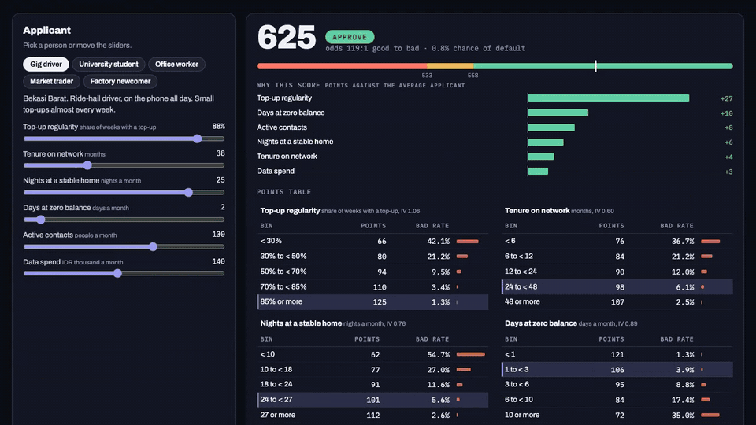

# Alternative credit scoring from telco data

**Live demo: https://dhaneswaramandrasa.github.io/alt-credit-scoring/**

[](https://dhaneswaramandrasa.github.io/alt-credit-scoring/)

An interactive, simulated version of a project I did at Eureka AI: a credit score for people with no bank credit file, built from how they use their phone. The production model reached a Gini of 0.6, the highest in the company's history. Case study: [Alternative credit score from telco data](https://dhaneswara-mandrasa.vercel.app/project-credit).

Operator and lender data can't be published, so this demo uses **60,000 synthetic subscribers in Jabodetabek**. The method is the same; the numbers are not real results.

## What it shows

**Scorecard tab**

| Part | What happens |
| --- | --- |
| Applicant | Five example people (gig driver in Bekasi, student in Depok, office worker on Sudirman, market trader in Tanah Abang, factory newcomer in Cikarang) or six sliders |
| Score | Points from each feature's bin, added up. 600 points at 50:1 odds good to bad, 20 points to double the odds. Approve from 558, review from 533, decline below |
| Why this score | Each feature's points minus the average applicant's points for that feature. For an additive scorecard this is exactly the SHAP value against the population average |
| Points table | Every bin with its points and bad rate; the applicant's bins are highlighted |
| Good and bad by score | Score curves for borrowers who repaid and who defaulted, on the 30% holdout. Drag the cutoff to see approval rate against bad rate among approved. Gini on the holdout: 0.63 |
| Stability | Population stability index (PSI) per month. A simulated SIM-bundle campaign from August brings in short-tenure subscribers and PSI passes 0.1 in November; the per-feature index (CSI) points to tenure |
| Map | Hexes about 2 km across, by average score or approval rate of subscribers who sleep there, with the feature that lifts and drags each area most |

**Pipeline tab** covers the related [AutoML credit scoring](https://dhaneswara-mandrasa.vercel.app/project-credit-automl) project: 24 candidate models across six families (the scorecard, logistic regression, decision tree, random forest, gradient boosting, a small neural network) trained on the same features and ranked by holdout Gini against train time. All of them are implemented in numpy in the build script and timed on the run. The before and after run time bars are the real result (75% faster), indexed, not measured here.

On this data the plain logistic models and the scorecard sit at the top, within 0.003 Gini of each other, while boosting and the neural network take 20 to 200 times longer for no gain. That is a common outcome on clean, mostly monotonic behaviour features, and the reason a points table is often what ships.

## The features

| Feature | What it stands for | IV |
| --- | --- | --- |
| Top-up regularity | share of weeks with at least one top-up | 1.06 |
| Days at zero balance | days a month the prepaid balance sits at zero | 0.89 |
| Nights at a stable home | nights a month the phone sleeps in its usual cell | 0.76 |
| Tenure on network | months on the same number | 0.60 |
| Active contacts | distinct people called or messaged a month | 0.25 |
| Data spend | IDR thousand a month | 0.13 |

## Data

| Part | Real or synthetic |
| --- | --- |
| Subscribers, their behaviour and whether they defaulted | Synthetic. A hidden creditworthiness per person, shifted by area, drives both the phone behaviour and the chance of default, with noise the phone never sees. `scripts/build_data.py` |
| Area centres in Jabodetabek | Real place names and approximate coordinates; the economic level of each is made up |
| Basemap | © OpenStreetMap contributors, tiles by OpenFreeMap |

## Run it

```bash
pip install -r requirements.txt     # numpy only
python scripts/build_data.py        # about 30 s; writes web/data/credit.json
python -m http.server -d web 8000   # open http://localhost:8000
```

The script simulates the subscribers, bins the six features, computes weight of evidence, fits the logistic regression (Newton steps), scales it to points, and then runs the model search. `web/index.html` is a single static page (MapLibre GL + deck.gl from a CDN). `?persona=student` (or `driver`, `office`, `trader`, `arrival`) opens a given applicant, `?tab=pipeline` opens the second tab and `?embed` hides the header. GitHub Actions deploys `web/` to Pages on every push to `main`.

## Layout

```
scripts/build_data.py   synthetic subscribers, WoE scorecard, PSI, map, model search, JSON export
web/index.html          the demo
web/data/credit.json    everything the demo reads
```
